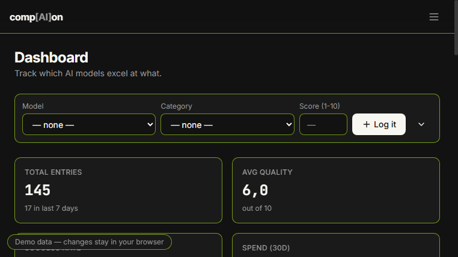
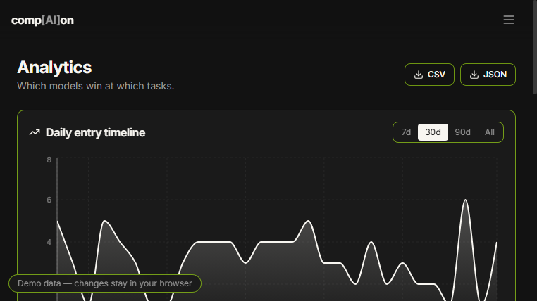
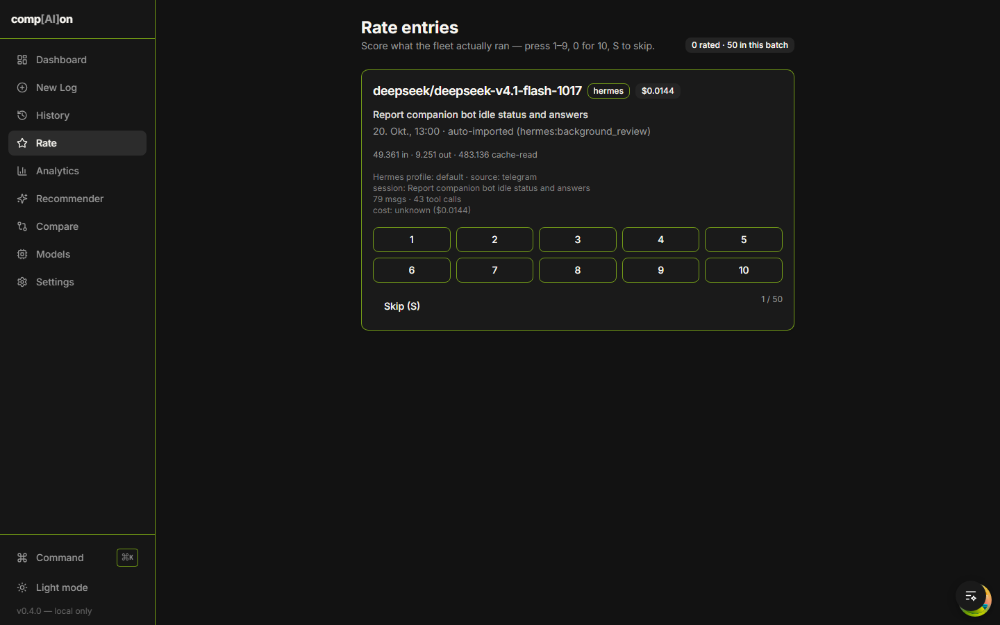

# comp[AI]on

A local-first developer log and dashboard for tracking daily AI-model consumption — which models (local, web, or agentic) actually earn their keep for which tasks, with quality scores, token usage and spend.

[](https://github.com/daniilperkin/comp-AI-on/actions/workflows/ci.yml)
[](https://daniilperkin.github.io/comp-AI-on/)
[](LICENSE)

**Live demo** (in-browser sample data, no backend): https://daniilperkin.github.io/comp-AI-on/



## Features

- **Quality-focused logging** — score every AI interaction 1–10 with outcome, category, tokens and latency; quick-add from the dashboard, full form, edit/delete
- **Analytics** — daily timeline (7/30/90-day ranges), model leaderboard, quality × category matrix
- **Spend tracking** — per-model $/MTok prices derive costs automatically; explicit costs win; 30-day and all-time totals, per-day and per-model breakdowns
- **OpenRouter usage sync** — pull real API activity in, deduped across re-syncs
- **Hermes usage sync** — import every local Hermes Agent profile's usage from its `state.db` (read-only); unknown model slugs are auto-registered so spend and the leaderboard attribute them
- **Rate queue** (`/rate`) — keyboard-driven scoring of imported entries (1–9, 0 = 10, S to skip)
- **Recommender & compare** — "best tool for this task" (Bayesian-shrunk quality) and side-by-side model comparison
- **Notifications** — once-daily reminder (OS toast, in-browser overlay, Telegram/Discord webhooks) and an optional daily USD budget warning
- **Exports** — CSV/JSON with filters, plus a monthly per-model summary endpoint
- **Optional Firebase mirror** — push a read-only copy to Firestore for a phone view and backup; strictly opt-in ([`firebase/README.md`](firebase/README.md))

## Screenshots

| Analytics | Rate queue |
|---|---|
|  |  |

## Stack

- **Frontend**: React 18 + Vite + TypeScript + Tailwind CSS 3 (hand-written shadcn-style components) + Recharts
- **Backend**: Python 3.11+ · FastAPI · SQLModel/SQLAlchemy · SQLite · APScheduler · Alembic
- **Tests**: Vitest (29) · pytest (123) · Ruff · ESLint

## Quick start

Requires Python 3.11+ and Node 20+ on PATH. Either launcher auto-creates the
virtualenv, installs both dependency sets, starts both servers **without any
console windows**, and opens the browser:

```
start.bat        # or start.vbs for a completely silent launch (no flash at all)
```

Stop with `stop.bat`. Server output goes to `logs/` (`backend.log`,
`frontend.log`, `launcher.log`, `setup.log`).

- Frontend: http://localhost:6769 (Vite proxies `/api` to the backend)
- API: http://localhost:8765/api

For development with hot reload in a single console: `.\start.ps1 -Windowed`
(Ctrl+C stops both). Manual per-server commands are in [`AGENTS.md`](AGENTS.md) §4.

### Resetting the database

Delete `backend/database.db` (plus `-wal`/`-shm` sidecars) and restart — the
schema is rebuilt by Alembic and defaults are re-seeded.

## Configuration

Everything is optional; copy [`.env.example`](.env.example) to `.env` to
override. Notable variables: `COMPANION_DB_PATH`, `COMPANION_TIMEZONE`,
`COMPANION_HERMES_HOME`, `COMPANION_FIREBASE_CREDENTIALS` +
`COMPANION_FIREBASE_PROJECT_ID` (mirror only).

## Development

```bash
# backend (from the repo root)
backend/.venv/Scripts/python.exe -m pytest backend/tests   # 123 tests
backend/.venv/Scripts/python.exe -m ruff check backend

# frontend (from frontend/)
npm test          # 29 tests
npm run lint
npm run build     # production build (also type-checks)

# alternate builds
VITE_DATA_SOURCE=demo PAGES_BASE=/comp-AI-on/ npm run build -- --outDir dist-demo
VITE_DATA_SOURCE=firestore npm run build:mirror
```

Data sources are chosen at build time (a Vite alias swaps `@/lib/api`): local
backend by default, in-browser fixtures for the Pages demo, Firestore for the
read-only mirror. CI ([`ci.yml`](.github/workflows/ci.yml)) runs lint + tests +
build on every push; [`pages.yml`](.github/workflows/pages.yml) deploys the demo.

## Project layout

```
comp[AI]on/
├── start.bat / start.ps1     # one-click launchers (venv + deps + both servers)
├── backend/                  # FastAPI app, syncs (OpenRouter/Hermes/Firebase), Alembic, tests
├── frontend/                 # Vite + React + Tailwind app, demo & mirror transports
├── firebase/                 # Firestore rules + mirror setup guide
├── docs/                     # design screenshots and plans
└── AGENTS.md                 # canonical contributor/agent guide (conventions, commands)
```

## Limitations

- Synced Hermes usage rows are cumulative per session, so per-day views can
  overcount multi-day sessions.
- Hermes cost figures use Hermes' stored provider-catalog estimates, not a
  reconciled bill.
- Quality is manual by design — no model grades itself into your leaderboard.

## Security & privacy

- **100% local by default**: no telemetry, no accounts, all data in
  `backend/database.db`. The API has no authentication — don't expose the port
  to untrusted networks.
- The Firebase mirror is opt-in and one-way; credential-looking settings are
  filtered before anything leaves the machine, and Firestore rules allow reads
  only for signed-in Google accounts (writes: backend only).

## Licence

[MIT](LICENSE) © 2026 Daniil Perkin
